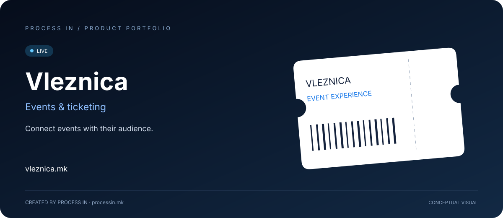

# Vleznica

**Connect events with their audience.**

[English](README.md) · [Македонски](README.mk.md)

**LIVE** · Confirmed by the owner

## The product

Vleznica is an event discovery and ticketing platform. Its public experience brings event categories, organizer information and sales-point access together.

## How to get started

| Step | Action |
|---|---|
| 01 | Find an event |
| 02 | Review event information |
| 03 | Select an available ticket type |
| 04 | Follow the official purchase instructions |

## Core capabilities

| Area | What it offers |
|---|---|
| **Event search** | Find events through the public search. |
| **Categories** | Browse music, theatre and sport. |
| **Organizer directory** | Explore organizers. |
| **Organizer access** | Apply or sign in as an organizer. |
| **Sales points** | Dedicated application and sign-in sections. |
| **Ticket information** | Review the selected ticket type and final price. |

## Who it is for

Event audiences, organizers and ticket sales partners.

## Practical scenario

A visitor can browse a category and check event details before selecting tickets.

## Product experience

The illustration above presents the product's purpose conceptually. Visit the official website for the current interface, available options and terms.

## Product information

| Detail | Value |
|---|---|
| Website | [vleznica.mk](https://vleznica.mk/) |
| Category | Events & ticketing |
| Status | LIVE |
| Developer | [PROCESS IN](https://processin.mk) |
| Portfolio contact | [contact@processin.mk](mailto:contact@processin.mk) |

Presentation sources: [1](https://vleznica.mk/).

### [Visit Vleznica](https://vleznica.mk/)

[PROCESS IN — Your Enterprise Software & AI Partner](https://processin.mk)

---

Public product showcase. No proprietary application code, customer data or production secrets are included. This presentation does not grant an open-source license to the product.
